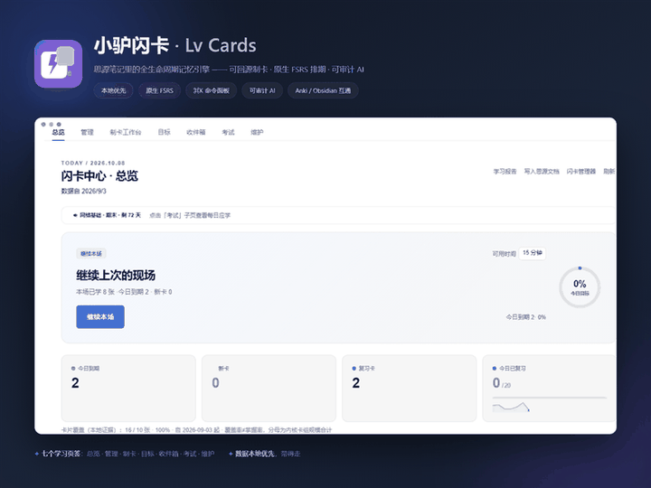
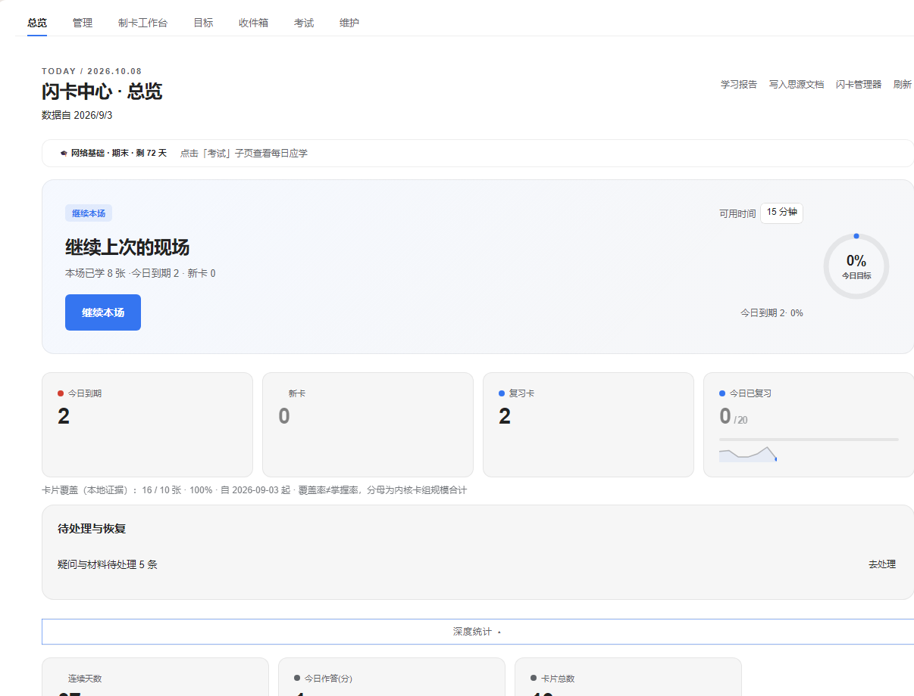
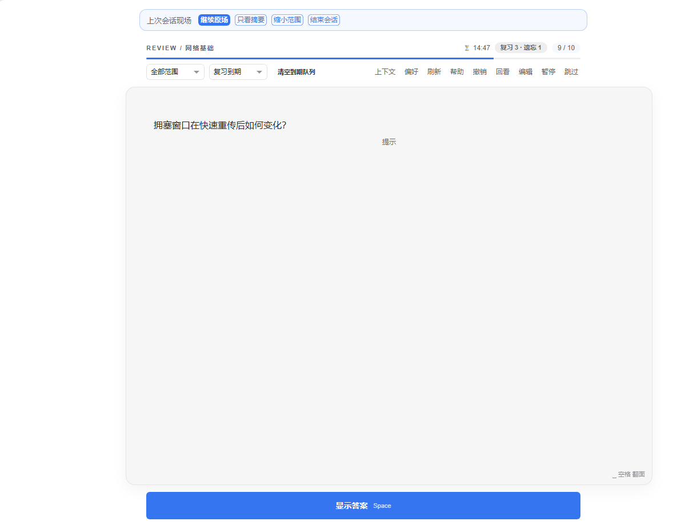
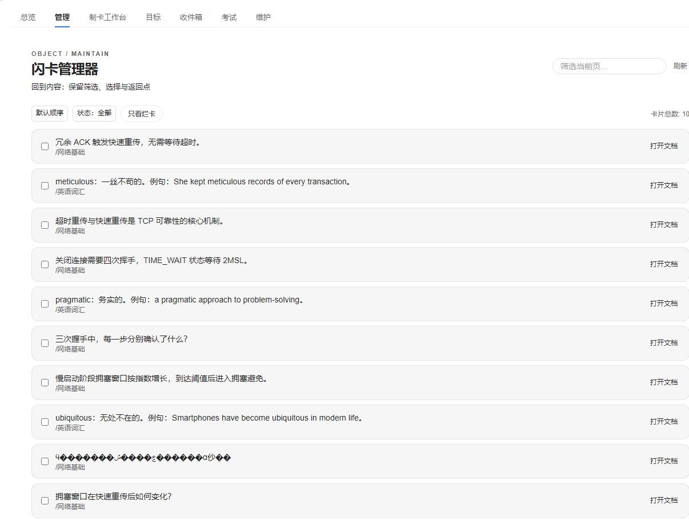
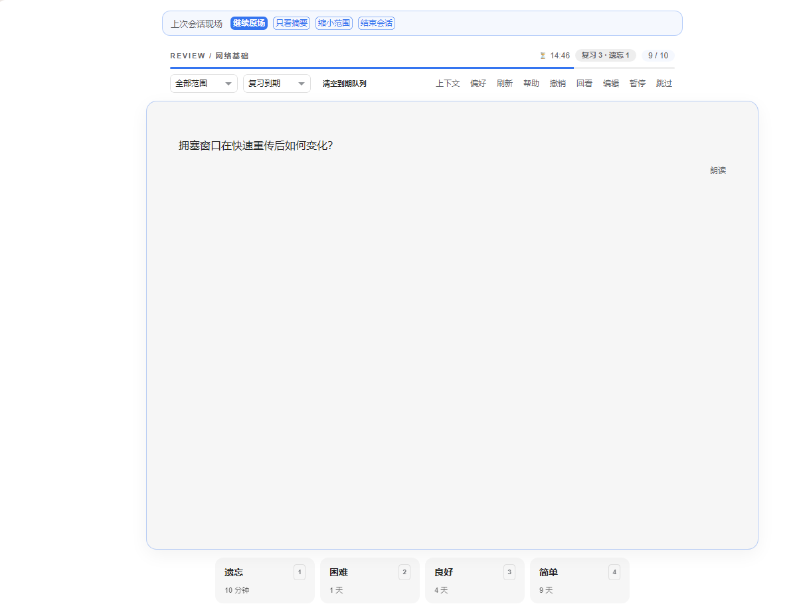

# Lv Cards (Beta) · 小驴闪卡（内测版）

**Turn your notes into long-term knowledge you can actually use.**

The full-lifecycle flashcard learning platform for SiYuan — local-first, native FSRS scheduling, auditable AI assistance

中文 ｜ [English](./README.en.md)

> **Note**: The primary README and all design docs are in Chinese. This page covers the essentials; see [docs/](./docs/README.md) for full design material.

Lv Cards turns blocks worth remembering into traceable flashcards, scheduled by SiYuan's native FSRS algorithm with optional, auditable AI assistance. The current version is **v0.210.36** (2026-10-23), delivering empty enter fill flip, Y/N true/false key bindings, and table scroll containment. See [GitHub Release](https://github.com/ai68298100/siyuan-lv-cards/releases/tag/v0.210.36) for the package and publishing status.

## What's New in v0.210.36

- **Empty Enter Fill Flip Flow**:
  - Resolves keyboard blockage when skipping fill inputs: pressing `Enter` with empty text instantly reveals the answer without friction.
- **Y/N True/False Key Aliases**:
  - Added support for `Y` (Yes/True) and `N` (No/False) keys on judge cards alongside `T/F` and `1/2`.
- **Table Overflow Scroll Containment**:
  - Styled content tables with `max-width: 100%; display: block; overflow-x: auto;` to protect the 880px stage width.
- **Verification**:
  - 1941 tests across 242 test suites 100% passing; zero TypeScript/Svelte errors and warnings; production build and smoke tests green.

## Previous Update: v0.210.35

- **Automatic Check-in Item Probing & Dropdown Binding**:
  - Automatically queries available check-in items from Little Donkey Check-in via the public bridge (`queryItems`).
  - Renders a native select dropdown when installed for effortless one-click binding, with graceful input fallback.
- **Verification**:
  - 1941 tests across 242 test suites 100% passing; zero TypeScript/Svelte errors and warnings; production build and smoke tests green.

## Previous Update: v0.210.34

- **Ecosystem Federation (Epoch 6 Standards)**:
  - Quad-alias mounting and safe teardown: `xiaolvCards`, `lvCards`, `LvCards`, `siyuanCards`.
  - Added `hasCapability` and `getOverview` contract methods (promoted from `design` to `stable`).
  - Automated check-in integration with Little Donkey Checkin on review completion (`logCheckinEventSafely`).
  - Registered `cards-due-summary` widget with Little Donkey Raikiri.
- **Topbar Vector Icon Overhaul (FSRS Lightning & Diamond Star)**:
  - Upgraded from generic double boxes to custom 32×32 monochrome vector: 8° tilted flipped cards with FSRS memory lightning and star badge.
- **CSS Hygiene & Aesthetic Tokens**:
  - Eliminated bare class pollution (`.dialog-content`, `.list`) by strictly scoping within `.lv-cards-*`.
  - Injected brand colors: Burgundy Red (`#E11D48`) and Starlight Gold (`#FACC15`).
- **Engineering & Distribution Optimization**:
  - Added `"settingsWindow": true`, elevated `minAppVersion` to `"3.8.4"`.
  - Slimmed `package.zip` down to 732KB (below 750KB ceiling) with automated `zh_CN.json` compatibility.
- **Verification**:
  - 1941 tests across 242 test suites 100% passing; zero TypeScript/Svelte errors and warnings; production build and smoke tests green.

## Previous Update: v0.210.33

- **Vector Streak Badges (No Emoji)**:
  - Replaced emojis with crisp, theme-aware `<LvIcon />` SVG badges on the streak and overview cards.
- **Verification**:
  - 1941 tests across 242 test suites 100% passing; zero TypeScript/Svelte errors and warnings; production build and smoke tests green.

## Previous Update: v0.210.32

- **Arrow Keys One-Hand Rating Flow**:
  - Rate cards seamlessly with arrow keys (`← Again`, `↓ Hard`, `→ Good`, `↑ Easy`) for ergonomic one-hand keyboard mastery.
- **Comprehensive Shortcut Guide**:
  - Fully updated the `?` help overlay with arrow ratings, zen mode `z`, starring `*`, and undo `p / q`.
- **Verification**:
  - 1941 tests across 242 test suites 100% passing; zero TypeScript/Svelte errors and warnings; production build and smoke tests green.

## Previous Update: v0.210.31

- **Focus-within Breathing Ring on Blank Input**:
  - Emits a gentle 3px brand-tinted glow on focus, anchoring attention and giving tangible feedback while typing.
- **Micro-Interaction State Tightening**:
  - Consistent `:focus-visible` outlines and stabilized interactive containers per UI/UX Pro-Max standards.
- **Verification**:
  - 1941 tests across 242 test suites 100% passing; zero TypeScript/Svelte errors and warnings; production build and smoke tests green.

## Previous Update: v0.210.30

- **True/False Card Keyboard Hint Badges**:
  - Aligned monospace hint tags (`[T / 1]` and `[F / 2]`) with interactive hover glow and clean typography.
- **Vector Semantic Icon Polish (UI/UX Pro-Max Standards)**:
  - Replaced ad-hoc emojis with high-contrast, scalable SVG icons across review done banners and manager lists.
- **Verification**:
  - 1941 tests across 242 test suites 100% passing; zero TypeScript/Svelte errors and warnings; production build and smoke tests green.

## Previous Update: v0.210.29

- **Settings Center Bury Siblings Toggle**:
  - Added dedicated toggle and bilingual explanations in the Review settings panel.
- **Complete Internationalization (i18n) Key Alignment**:
  - Resolved missing keys for `starredFilter` and aligned 2609 bilingual keys across 1046 code sites.
- **Verification**:
  - 1941 tests across 242 test suites 100% passing; zero TypeScript/Svelte errors and warnings; production build and smoke tests green.

## Previous Update: v0.210.28

- **Bury Siblings Spoiler Prevention (Anki-grade)**:
  - Intelligently detects and buries sibling cards derived from the same source block (`blockID`) within the same session.
  - Ensures genuine cognitive retrieval effort (Desirable Difficulty) rather than artificial familiarity from adjacent cloze context.
  - Automatically suspends burying during Cram/Sprint mode for comprehensive exam prep.
- **Verification**:
  - 1941 tests across 242 test suites 100% passing; zero TypeScript/Svelte errors and warnings; production build and smoke tests green.

## Previous Update: v0.210.27

- **Smart Typo Tolerance (Levenshtein Distance)**:
  - Grants credit (suggested rating 3 Good) for minor 1-character typos/omissions while strictly preserving BX-1 numeric precision.
- **Manager Starred Filter & Orphan Card Badges**:
  - Filter card databases with `[ ⭐ Starred Only ]`, view status indicators, and locate missing/orphan blocks.
- **Zen Focus Review Mode**:
  - Hide toolbars and distractions with `z` or via the menu for deep flow review.
- **Multi-Round Verification**:
  - 1938 tests across 241 test suites 100% passing; zero TypeScript/Svelte errors and warnings; production build and smoke tests green.

## Previous Update: v0.210.26

- **Done Panel Quiz Accuracy Badge**:
  - Automatically tallies interactive quiz attempts and accuracy percentage (e.g. 80% 4/5) with a glowing status bubble (`.lv-done-quiz-bubble`).
- **Complete WAI-ARIA Screen Reader Protection**:
  - Injected `role="radiogroup"`, `role="radio"`, `role="group"`, and `role="checkbox"` with synchronized `aria-checked` attributes for full screen reader accessibility.
- **Visual Keyboard Hint Badges on Choice Cards**:
  - Rendered subtle monospace shortcut badges (`[A]`, `[B]`, `[C]`, `[D]`) on cards that highlight on hover/focus.
- **Verification**:
  - 1936 tests across 241 test suites 100% passing; zero TypeScript/Svelte errors and warnings; production build and smoke tests green.

## Previous Update: v0.210.25

- **Multimodal Audio & Haptic Feedback on Quiz Responses**:
  - Plays uplifting Web Audio synthesizer chimes and subtle haptics on correct answers; low gentle tones on errors.
- **Autofocus Fill-in-the-Blank Inputs**:
  - Automatically focuses the answer input when a fill-in card is loaded, allowing immediate typing without mouse interaction.
- **Smooth Analysis Card Transitions**:
  - Analysis explanations expand with fluid opacity and motion easing upon card flip.
- **Verification**:
  - 1936 tests across 241 test suites 100% passing; zero TypeScript/Svelte errors and warnings; production build and smoke tests green.

## Previous Update: v0.210.24

- **Full Multiple-Choice Submission Flow**:
  - Interactive multi-selection toggles with visual checkmark states and an inline `[ Submit Answers (Enter) ]` action.
  - Granular feedback: completely correct (3 Good), partial credit with omission alerts (2 Hard), and incorrect (1 Again).
- **Shortcut Guide Overlay Updates**:
  - Added explicit instructions for `A / B / C / D` options and `T / F` true/false keys in the `?` help modal.
- **Verification**:
  - 1936 tests across 241 test suites 100% passing; zero TypeScript/Svelte errors and warnings; production build and smoke tests green.

## Previous Update: v0.210.23

- **One-Key Speed Flow (Space / Enter Instant Rating)**:
  - Once revealed, pressing `Space` or `Enter` automatically submits the recommended rating (e.g. Good 3) and advances immediately to the next card.
- **Explicit Dual-Clock Semantic Chips**:
  - Clear distinctions between session budget time (`Total Left 14:38`) and single-card timeout (`Limit 0:39`), preventing timer confusion.
- **Redundant Option Text Filtering**:
  - Automatically hides raw `ul`/`ol` list text when interactive option cards are active, maintaining a clean stem presentation.
- **Verification**:
  - 1936 tests across 241 test suites 100% passing; zero TypeScript/Svelte errors and warnings; production build and smoke tests green.

## Previous Update: v0.210.22

- **Interactive Choice Option Matrix (Single & Multiple Choice)**:
  - Automatically parses options (A/B/C/D) and renders tactile choice cards with instant correctness feedback and automatic flip-to-analysis.
  - Supports full keyboard shortcuts (A/B/C/D or 1/2/3/4).
- **Interactive Judgment Cards (True / False)**:
  - Renders prominent True/False interactive capsules with keyboard triggers (T/1 or F/2) and instant grading.
- **Embedded Interactive Fill-in-the-Blank Box**:
  - Provides an inline input box for fill-in-the-blank cards with instant Enter-to-check diff grading.
- **Elevated Card Aesthetics & Floating Action Dock**:
  - Balanced padding and multi-layered ambient shadows on `.lv-card` for an elevated quiz look;
  - Transformed the reveal action into a modern floating action dock with keyboard badges;
  - Recommended ratings (e.g. Good 3) feature an intelligent breathing pulse (`.lv-btn-suggested`) for effortless flow.
- **Verification**:
  - 1936 tests across 241 test suites 100% passing; zero TypeScript/Svelte errors and warnings; production build and smoke tests green.

## Previous Update: v0.210.21

- **Unified Rich Card Scopes (`.lv-unified-face` & `.lv-card-content`)**:
  - Unified review faces, detail drawer previews, and card authoring components under both scope classes;
  - Guaranteed strict element sizing for list bullets, task checkboxes, Excalidraw canvases, and code blocks across all themes.
- **Mid-Viewport Grid Hardening (560px–780px)**:
  - Corrected stat grid container queries to maintain a clean 2x2 grid without squeezing into four columns on split screens.
- **Bento Ready Grid Elasticity**:
  - Enhanced empty-queue action cards with `minmax(220px, 1fr)` auto-wrapping for fluid responsive scaling.
- **Verification**:
  - 1929 tests across 240 test suites 100% passing; zero TypeScript/Svelte errors and warnings; production build and smoke tests green.

## Previous Update: v0.210.20

- **Fill-in-the-Blank Underscore Masking (`_{3,}`)**:
  - Automatically maps consecutive underscores (e.g. `_____`) into click-to-reveal blank slots in question mode.
- **Quote Block (`blockquote`) Analysis Spoiler Prevention**:
  - Safely masks secondary explanation quotes behind `[ Explanation (revealed with answer) ]` during question mode, preventing immediate spoilers.
  - Seamlessly integrates with Little Donkey Exam attributes (`custom-exam-answer`, `custom-exam-analysis`).
- **Single-Line Equal-Height Review Toolbar**:
  - Locked toolbar row layout with `flex-wrap: nowrap` to prevent the `··· More` button from dropping into a lonely second row;
  - Unified all selects, pills, and buttons to a clean 28px height with responsive icon-only collapsing on narrow viewports.
- **Verification**:
  - 1929 tests across 240 test suites 100% passing; zero TypeScript/Svelte errors and warnings; production build and smoke tests green.

## Previous Update: v0.210.19

- **Fixed Giant Black Circles in Multiple-Choice / Fill-in-the-Blank Cards**:
  - Excluded `#iconDot` list bullets and `.protyle-action` SVG elements from vector canvas expansion;
  - Added strict 10px bullet and flex-aligned layout to restore clean multiple-choice options.
- **Fixed Deck Grid Column Squeezing on Ultra-Wide Displays**:
  - Increased deck card min-width from 180px to 280px with clean text truncation to prevent single-character vertical text wraps.
- **Unified Hero Time Budget & Week Habit Strip**:
  - Grouped "Time Budget" with status tags into a cohesive pill group, removing awkward empty space;
  - Aligned checked-in week day styling with clear filled checkmark badges.
- **Polished Review Scope Toolbar & Objective Badges**:
  - Styled session completion criteria as a styled badge (`.lv-purpose-end-chip`) with an explicit target icon, eliminating confusion with action buttons.
- **AI 404 Error Guidance & URL Normalization**:
  - Automatically strips trailing `/chat/completions` from endpoint URLs;
  - Provides clear troubleshooting instructions for HTTP 404 (checking `/v1` prefix or model name).
- **Verification**:
  - 1928 tests across 240 test suites 100% passing; zero TypeScript/Svelte errors and warnings; production build and smoke tests green.

## Previous Update: v0.210.18

- **Native Slash Menu (`protyleSlash`) Card Creation**:
  - Type `/zk`, `/card`, or `/shanka` in any document block to instantly trigger card creation into target decks directly from the editor.
- **Official Petal Lifecycle Alignment**:
  - Implemented the official `uninstall()` plugin teardown hook to clean up topbar entries, heartbeats, and references on deletion;
  - Conformed to SDK 1.2.9 native `addTopBar` `contextMenu` option.
- **Deep Deck Management Integration**:
  - Integrated official kernel `/api/riff/renameRiffDeck` and `/api/riff/removeRiffDeck` endpoints with inline renaming and confirmed deletion directly from the dashboard.
- **Verification**:
  - 1928 tests across 240 test suites 100% passing; zero TypeScript/Svelte errors and warnings; production build and smoke tests green.

## Previous Update: v0.210.17

- **Goal Editing & Modification Completion**:
  - Restored the missing **`[ Edit ]`** action on goal cards with complete state hydration (`startEdit(goal)`);
  - Users can now update target minutes, deadlines, proficiency levels, and completion criteria without having to recreate goals.
- **Exam Plan Card Visual Divider**:
  - Added clean top border dividers (`border-top`) to exam plan card action rows for refined visual hierarchy.
- **Verification**:
  - 1928 tests across 240 test suites 100% passing; zero TypeScript/Svelte errors and warnings; production build and smoke tests green.

## Previous Update: v0.210.16

- **Manager Toolbar Responsive Alignment**:
  - Encapsulated page total counter and select-all pill inside `.lv-toolbar-right` to eliminate line wrapping misalignment on compact displays;
  - Fully aligned list item accessibility labels (`aria-label`) to preserve screen reader fidelity alongside search highlights.
- **Decoupled Deck Card Action Targets**:
  - Upgraded deck items from a single button into cleanly separated touch targets: title click for manager filtering, and dedicated pill button for quick review.
- **Verification**:
  - 1928 tests across 240 test suites 100% passing; zero TypeScript/Svelte errors and warnings; production build and smoke tests green.

## Previous Update: v0.210.15

- **Search Keyword Highlighting in Manager**:
  - Matched search terms in card excerpts are highlighted with a gentle amber pill marker (`<mark class="lv-search-hit">`);
  - Strictly preserves WAI-ARIA accessible text via `aria-label` for smooth screen reader compatibility.
- **In-Review Live Font Zoom Control**:
  - Added dedicated **`[ A− ] [ A+ ]`** font adjustment group directly on the review toolbar;
  - Real-time scaling from 80% to 160% without leaving the active review session.
- **Instant Undo Toast Feedback**:
  - Pressing `z / p / u` triggers an immediate informative toast confirming that the previous card and queue state were restored.
- **Verification**:
  - 1928 tests across 240 test suites 100% passing; zero TypeScript/Svelte errors and warnings; production build and smoke tests green.

## Previous Update: v0.210.14

- **Manager Select All on Current Page**:
  - Added dedicated **`[ ☑ Select Page / Deselect All ]`** pill button in the manager toolbar;
  - Instantly toggles selection across all cards on the loaded page, dramatically speeding up batch deck assignment, migration, and export.
- **Review Shortcut Help Overlay Alignment**:
  - Fully updated the in-review shortcut modal with `Shift+Space` (reveal all), `r` (reverse Q&A recall), and `z / p / u` (undo).
- **Verification**:
  - 1928 tests across 240 test suites 100% passing; zero TypeScript/Svelte errors and warnings; production build and smoke tests green.

## Previous Update: v0.210.13

- **Dashboard One-Click Deck Review Action**:
  - Added dedicated **`[ 🗂️ Review ]`** action pill directly beside each deck card in the "My Decks" dashboard section;
  - Instantly launches review locked to the chosen deck (`scope=deck:<id>`) without extra configuration;
  - Preserves deck title click for manager browsing, providing dual pathways for exploration and learning;
  - Expanded deck preview capacity from 4 to 6 decks.
- **Verification**:
  - 1928 tests across 240 test suites 100% passing; zero TypeScript/Svelte errors and warnings; production build and smoke tests green.

## Previous Update: v0.210.12

- **Step-by-Step Progressive Cloze Recall**:
  - Independent cloze slot reveal: click any masked slot (`[ 1: Recall Here ]`) to reveal it individually without spoiling subsequent slots.
  - Keyboard workflow: press Space to progressively reveal the next slot, or `Shift+Space` to reveal all. Rating buttons automatically expand once all slots are uncovered.
- **Professional Interactive Zoom & Pan Lightbox**:
  - Smooth wheel zoom (0.5x to 4x) with click-and-drag panning for detailed diagrams and anatomy illustrations.
  - Double-click toggles between 1:1 pixel scale and viewport fit, with a floating zoom percentage pill.
- **On-the-fly Reverse Q&A Recall (R)**:
  - Added **`[ ⇄ Reverse Q&A (R) ]`** in review toolbar to instantly test bidirectional recall without touching source notes.
- **Visual Physical Key Feedback**:
  - Instant tactile-style spring depression animation on ratings buttons when pressing keys `1`, `2`, `3`, `4`, or `Space`.
- **Verification**:
  - 1928 tests across 240 test suites 100% passing; zero TypeScript/Svelte errors and warnings; production build and smoke tests green.

## Previous Update: v0.210.11

- **Review Completion Elevation & Retention Indicator**:
  - Added an illuminated retention rate bubble on session completion with visual performance badges;
  - Added one-click **`[ 🔥 Reinforce Lapses ]`** action to immediately practice forgotten cards from the current session;
  - Streamlined action bar layout for enhanced post-review accomplishment.
- **Verification**:
  - 1928 tests across 240 test suites 100% passing; zero TypeScript/Svelte errors and warnings; production build and smoke tests green.

## Previous Update: v0.210.10

- **Silent Topbar & Removal of Intrusive Badge Numbers**:
  - Removed the loud red badge ball from the topbar icon to eliminate notification stress;
  - Due card counts and goal status are now gracefully presented in the native hover tooltip (`title` / `aria-label`).
- **Review Ready Hub & Bento Action Grid**:
  - Transformed the desolate empty queue state into an elegant Review Ready Dashboard;
  - Quarantined cards are cohesively embedded inside the dashboard with clear diagnostics and one-click repair actions;
  - Bento matrix: Ahead-of-Time Cram practice, new cards practice, authoring studio, inbox, card manager, and maintenance.
- **Verification**:
  - 1928 tests across 240 test suites 100% passing; zero TypeScript/Svelte errors and warnings; production build and smoke tests green.

## Previous Update: v0.210.9

- **Native & Ecosystem Card Review Presentation Elevation**:
  - Enhanced review interface for native SiYuan prompt cards, block memo answers, third-party plugin attributes, and delimited syntax.
  - Dynamic card badges: `[ 📖 Native Card ]`, `[ 💡 Memo Answer ]`, `[ 💡 Plugin Answer ]`, `[ 💬 QA ]`, `[ ✏️ Cloze ]`, `[ 💻 Code ]`, `[ 🖼️ Occlusion ]`.
  - Native self-rating prompt banner: gently informs users that their note blocks remain completely unmodified and guides self-assessment.
  - Illuminated answer callout: displays block memo and plugin attributes (`custom-card-answer`, etc.) with refined styling.
- **Card Package & Batch Deck Organization**:
  - Added **`[ 📁 Add to Deck ]`** and **`[ 📦 Move to Deck ]`** in the Card Manager batch action bar.
  - Supports choosing existing decks or creating new decks on the fly; seamlessly moves cards between decks.
- **Quick Cloze Wrapping & Keyboard Shortcut**:
  - Added dedicated **`[ == Cloze == ]`** button in the Card Editor header.
  - Supports `Ctrl+H` / `⌘H` shortcut to wrap selections with `==...==` or insert a blank placeholder instantly.
- **Verification**:
  - 1928 tests across 240 test suites 100% passing; zero TypeScript/Svelte errors and warnings; production build and smoke tests green.

## Previous Update: v0.210.8

- **Zero-Mutation Legacy & Native Flashcard In-Place Compatibility**:
  - Established a strict zero-mutation guarantee that leaves user notes 100% untouched while enabling seamless flashcard review across all existing formats.
  - Native SiYuan prompt cards (`free-recall`): review cards directly with an elegant `[ 📖 Native Card ]` badge and answer self-rating guidance.
  - Block memo & plugin answer attributes: automatically displays `memo`, `custom-card-answer`, `custom-flashcard-answer`, and `custom-card-memo` as illuminated answer callouts.
  - Delimited QA syntax (`::`, `:::`, `Q: / A:`, `问：/ 答：`): dynamically masks answers in memory during the question phase and reveals them on flip without modifying source markdown files.
  - Syntax safety guards: excluded C++ / Rust namespaces (`std::vector`, `std::cout`) and code/math blocks from delimiter parsing.
- **Maintenance Health & User-Controlled Normalization**:
  - Native and legacy cards are treated as healthy cards in maintenance health scans.
  - Optional normalization tool with explicit warning dialog stating that note conversion is completely optional and existing cards are already 100% reviewable.
- **Full-Spectrum UI & Visual Elevation (Inspired by Modern Reference Aesthetics)**:
  - Dashboard: warm amber streak hero card, 7-day pill habit strip, smooth spline retention curve with gradient area shading, and Bento card layout.
  - Review: 6px pill progress bar, alarm clock timer badge, pill context breadcrumbs, and 4-tier rating top color bars.
  - Kits: fully rounded pill segmented controls, pill facet tabs, and ambient micro-shadow elevations.
- **Verification**:
  - 1928 tests across 240 test suites 100% passing; zero TypeScript/Svelte errors and warnings; production build and smoke tests green.

## Previous Update: v0.210.7

- **Excalidraw SVG Canvas Recognition & Image Occlusion Support (Issue #14)**:
  - Extended flashcard quality gate (`flashcard-quality.ts`) to recognize inline `<svg>` elements, Excalidraw file references (`.excalidraw.svg`), and SiYuan widget blocks as valid flashcard materials.
  - Sanitized and protected inline SVG vector rendering in `card-face.ts`, preventing SVG tags from being escaped as plaintext.
  - Supported SVG elements alongside `` in `occlusion-editor.svelte` and `review.svelte`, enabling precise occlusion mask drawing and review placement over SVG diagrams.
- **Scalar Numeric Answer Policy Engine (BX-1)**:
  - Implemented high-precision numeric evaluation in `scalar-numeric-policy.ts` with SI unit conversions, derived prefixes, absolute/relative tolerance, zero-boundary guards, significant figures, and percent conversions.
- **Presentation & Screen Sharing Privacy Mode (BX-6)**:
  - Added privacy masking controller (`presentation-privacy.ts`) with topbar menu and command palette toggles, redacting block IDs, file paths, deck names, and sensitive personal data.
- **Review Context Breadcrumbs (BX-11 UI)**:
  - Displayed hierarchical source paths ("Notebook > Document > Section") at the top of flashcard review faces, reducing atomized card disorientation.
- **Package Diff Inspector & Conflict Resolution (BX-12)**:
  - Added field-level `.lvcards` import diff comparison with 4 resolution strategies (keep-local, overwrite, fork-new, merge-memo), protecting local private notes.
- **Misconception Cluster Map UI (BT-3 UI)**:
  - Visualized confusable concept pairs with severity badges and intervention suggestions (contrast, counterexamples, card splitting) in the maintenance tab.
- **Monotonic Clock Review Timeout (M3·FR8)**:
  - Upgraded review countdown timer (`review-countdown.ts`) to use monotonic wall clock timings, preventing drift during system sleep or tab throttling.
- **Dependency Upgrades & Issue Governance**:
  - Upgraded `vitest@5.0.5`, `js-yaml@5.5.0`, `svelte-check@4.7.7`, and `sass@1.105.2`.
  - Contained plugin menu icon sizing (16px isolation, Issues #12/#13).
- **Verification**:
  - 1914+ tests across 239 suites 100% passing; zero TypeScript/Svelte errors and warnings; production build and smoke tests green.

## Previous Update: v0.210.6

- **Topbar Item Self-Healing & Resilience (`ensureTopBarElement`)**: Registered fixed unique ID `id: "topbar-lv-cards"`. Implemented a self-healing controller that detects DOM disconnection when SiYuan redraws or reorganizes the toolbar during window resizing, automatically restoring the topbar button and preventing vanishing icons.
- **Data Reload Echo Suppression**: Strictly scoped `onDataChanged` file change events to private plugin storage; introduced a 3000ms timestamp window that filters out local self-write echoes, eliminating unexpected page re-renders and review UI flickering.
- **AI Capability Map & Risk Classification Matrix (BU-1 / BU-2)**: Established comprehensive capability registrations across 6 learning modes with non-tamperable scheduling assertions (`effectsKernel: false`), accompanied by a 5-tier action risk matrix.
- **SiYuan Agent Capability Negotiator & Loop Guard (BU-3 / BU-4)**: Implemented host kernel version and runtime probing with honest fallback, zero fake tool registrations, and an execution guard enforcing call limits, recursion depth caps, and unauthorized parameter blocking.
- **AI Data Boundary Retention Policy & Grounded Output Contract (BU-9 / BU-10)**: Bound AI assertions to source document blocks with mandatory `inferredTag` for ungrounded claims, ensuring AI deductions never masquerade as user facts.
- **Verification**: 1832 automated tests across 227 test suites passing; zero TypeScript/Svelte errors and warnings; production build and smoke-dist green.

## Previous Update: v0.210.5

- Fully upgrade and adapt to official SiYuan SDK `siyuan@1.2.9`, fixing `i18n` declaration typing conflicts with `JSONValue` assignments and `Custom` tab model contexts.
- Merge core dependency upgrades: `vite@8.3.4`, `@types/node@26.6.5`, `happy-dom@21.0.3`, `npm-run-all2@9.0.3`, and CI workflow `actions/setup-node@7.1.0`.
- Safe request contract adaptation: harmonize generated kernel API route signatures in `ai.ts` and `flashcardV2.ts`.
- Review & onboarding experience: streamlined review topbar with core 5 pinned actions and secondary tools collapsed into a clean `··· More` popover; added "Notes are Flashcards" empty state onboarding card.
- Post-release workspace fixes (not yet published as a new version): notebook AI material queries now include document roots; interleaved Obsidian deck hints preserve block mapping and persist the ledger after each successful group; the Learning hub now exposes recap, plans, and calendar facets with keyboard date selection and forecast retry; bidirectional quick-card creation reuses one target document.

## Previous Update: v0.210.1

- **Consistent card checks:** Creation, imports, and edits validate the final card before adding it. Ordinary cards require an answer marker and a visible question; image occlusion requires an image and valid regions. AI candidates gain high-confidence quality checks, and Anki/Obsidian imports gain safer cleaning and error feedback. These checks cannot establish factual accuracy; human review remains necessary.
- **Old cards and maintenance:** Invalid old cards are isolated for the current review session without changing due dates, ratings, or logs. Maintenance detects answer-only cards, checks media, offers side-by-side approximate-duplicate review with saved decisions, and returns to a fresh scan after editing.
- **Repair and source history:** Batch repairs offer drafts, before/after previews, confirmation, and a persisted repair journal. Failed repairs restore the exact old snapshot, including invalid old cards that normal editing checks would reject; successful batches expose conflict-protected undo while normal edits still require validation. A rollback is blocked when a card changed after repair, and the journal records repair events rather than every edit. Source fingerprints and issue history persist independently of the current deck, including detection and handling times.
- **Recovery and device behavior:** Failed lazy loads can be retried, maintenance work loads on demand within the existing 55 KiB gzip entry budget, and review gestures and keyboard-driven viewport changes have been improved. AI settings add OpenAI, DeepSeek, Ollama, and LM Studio presets.
- **Validation:** 1070 tests across 157 files, TypeScript/Svelte checks (0 errors and 0 warnings), 1679 aligned translation keys and 856 source references, documentation/governance checks, a clean production build, and package smoke pass. Smoke includes failed-repair compensation for invalid old cards through the production IIFE. The entry bundle is approximately 54 KiB gzip, within the 55 KiB budget. The five real SiYuan Chrome paths, Android host testing, and the real-model error matrix remain pending; automated checks do not replace them.

The current workspace validation (not a new release asset) is 1,202 tests across 169 files, 1,855 translation keys and 949 source references, `pnpm check`, production build/smoke, and isolated-kernel E2E 18/18. Real SiYuan Chrome, Android, real AI providers, third-party themes, screen readers, and multi-window persistence remain host-level acceptance work.

Previous releases

### v0.209.3 · 2026-10-10

- **New:** Classified AI generation failures (cancel, timeout, auth, rate limit, quota, server, and network), sensitive-material warnings, onboarding with example cards, a delayed short loop for forgotten cards, and manager keyboard navigation.
- **Improved:** Multiple-choice questions now degrade to two or three options or free recall when reliable distractors are unavailable. Review, dashboard, and manager views synchronize across windows and expose clearer loading, empty, error, retry, and disabled states.
- **Fixed:** Old AI responses, over-budget jobs, delayed requeues, undo, scope changes, and destroyed review panels no longer leave stale state behind.
- **Validation:** 747 unit tests, type/Svelte checks, i18n and documentation checks, governance checks, production build, and package smoke pass. Android host testing remains pending.

### v0.209.1 · 2026-10-10

- **Loading and recovery:** Dashboard refreshes preserve the last successful data with its timestamp. Deck, notebook, maintenance, challenge, pairing, and inbox actions now show clearer loading, empty, error, or retry states.
- **Action feedback:** Review controls, settings saves, and batch operations prevent duplicate submissions while busy. AnkiConnect checks use the current draft credentials.
- **Fixes:** Exiting a challenge invalidates pending card reads. Declining duplicate-card confirmation no longer creates the newly entered deck in advance.
- **Validation:** 736 unit tests, source checks, i18n and governance checks, documentation facts, production build, and package smoke pass. Android host testing remains pending.

### v0.209.2

- Updated marketplace metadata: explicit supported platforms and no unused sponsor placeholder.

### v0.209.0

- Fixed card creation on SiYuan 3.8.x, cloze answer leakage, empty all-deck due queues, knowledge-object panel crashes, and AI safety/rejection feedback.
- Fixed error-reason tags, live review preferences, and preset confirmation labels; aligned review shortcuts and terminology.

### v0.208.1

- Fixed wizard, drill, and card-detail callbacks; added visible feedback for lazy-load failures.

### v0.208.0

- Completed the Starline R53 UI refinement across page headers, review, component states, narrow layouts, and motion.

## 📸 Screenshots

| Overview — pick up where you left off | Review — recall first, check, then grade |
|---|---|
|  |  |
| **Manager** — back to content, with source & history | **Rating bar** — 4-button grading with interval preview |
|  |  |

## ✨ Features

| Module | Highlights |
|---|---|
| 🃏 **Review** | 4/3-button rating with interval preview · source-context preview · hint ladder · forgotten-card batch re-queue · undo · type-in grading (LCS diff) · dictation (TTS) · multiple choice · image occlusion · mixed question-type rotation · timeout mode · session resume |
| ✍️ **Create** | Block cards (multi-select) · cloze from selection · quick Q/A · marker scanning · AI batch generation (12-template prompt registry + provider fallback) · occlusion editor · manual editing with pre-save diff |
| 🧭 **Learning journey** | Material inbox → authoring workbench · learning goals (three-step chain + daily budget) · content lifecycle panel · entry context · wrap-up reasons · recovery banner · next-step suggestions |
| 📊 **Stats & diagnostics** | Heatmap · **study calendar with load forecast** · **deck dashboard** (per-deck due/retention/leech ranking) · streak · retention curve · capability share · error reasons · AI batch quality |
| 🗂 **Manage** | Paged browsing with search & filters · card detail drawer (content/source/learning record/issues — four facets + version tracking) · batch operations · export CSV / Obsidian SR · maintenance debt queue |
| 🎓 **Exam** | Daily targets from deadline · cram mode · post-exam report |
| 📦 **Share & migrate** | Obsidian SR import/export with deck mapping & fingerprint dedup · Anki `.apkg` import when the desktop host provides `node:sqlite` and `node:zlib` · deck-level share pack export · JSON/CSV review log export & import |
| ⌨ **⌘K palette** | Actions + navigation, keyboard-first access to every entry point |
| 📅 **Weekly report** | Auto-write last week's review summary to a SiYuan document (opt-in) |
| 🛡 **AI safety** | Preflight checks · prompt-injection isolation · context budget planner · emergency kill switch |

## 🚀 Install

SiYuan ≥ 3.8.0. Desktop is the core experience; mobile and browser are narrow-screen adapted (390px structural walkthrough recorded), while the full Android SiYuan host matrix remains pending.

1. Download `package.zip` from the [latest release](https://github.com/ai68298100/siyuan-lv-cards/releases/latest) (do **not** unzip)
2. SiYuan → Settings → Marketplace → Download → "Import package" → pick the zip
3. Enable "Lv Cards (Beta)" under Downloaded

## ⌨️ Quick start

1. Select a block → block icon → **Add to deck**
2. Press **Ctrl+K** for the command palette, or click the **donkey badge** in the top bar
3. In review: **Space** flips, **1-4** rates, `?` shows all shortcuts

## 📚 Docs

Full design docs in [docs/](./docs/README.md) (Chinese). The [R54 interactive prototype](./docs/prototypes/lv-cards-r54.html) is the single source of truth for UI structure, visual language, copy, interaction states, and responsive breakpoints; compare implementation evidence in the [R54 acceptance ledger](./docs/45-R54实现对照与验收台账.md) and component APIs in the [component catalogue](./docs/46-组件目录与状态契约.md). [R53 design spec](./docs/42-UI设计规范-R53.md) is retained as a historical reference. See also [product positioning](./docs/41-竞品调研与定位强化.md) · [user guide](./docs/21-用户上手指南.md) · [FAQ](./docs/20-FAQ与故障排查.md) · [privacy](./docs/PRIVACY.md). For development, see [CONTRIBUTING](./CONTRIBUTING.md); report bugs through [Issues](https://github.com/ai68298100/siyuan-lv-cards/issues) and security problems through [SECURITY](./SECURITY.md).

## 🗺 Roadmap

| Priority | Item | Status |
|---|---|---|
| P0 | ⌘K command palette | ✅ v0.206.3 |
| P0 | Learning calendar & load forecast | ✅ v0.206.4 |
| P1 | Weekly report | ✅ v0.206.7 |
| P1 | Deck dashboard | ✅ v0.206.8 |
| P1 | Share pack (deck-level Obsidian SR export) | ✅ v0.206.9 |
| P2 | 390px narrow-screen structural walkthrough | ✅ v0.206.10 |
| P1 | Starline UI overhaul (page heads / complete states / micro-motion / narrow screen / review polish) | ✅ v0.208.0 |
| P2 | Full Android SiYuan host matrix | Pending |
| P2 | Templates & fields | Deferred |

## 🙏 Credits

- Built on [plugin-sample-vite-svelte](https://github.com/siyuan-note/plugin-sample-vite-svelte)
- Scheduling: SiYuan kernel's native [go-fsrs](https://github.com/open-spaced-repetition/go-fsrs)
- Research: Anki, Obsidian Spaced Repetition, RemNote, Mochi, Quizlet, Knowt, and SiYuan community plugins — see [docs/41](./docs/41-竞品调研与定位强化.md)

## License

[MIT](./LICENSE) © ai68298100
